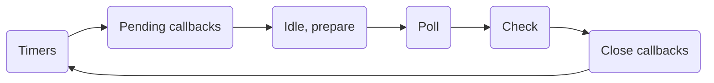

# Event Loop in Node.js

The Node.js event loop is implemented by **libuv** and runs in **phases**:
**timers** → **pending callbacks** → idle/prepare → **poll** → **check** →
**close callbacks**, then again. Each phase has its own queue of callbacks.
After **every** callback, Node.js empties the **`process.nextTick` queue** and
then the **microtask queue** (promises, `queueMicrotask`), and only then runs
the next callback. The loop ends when there are no timers, pending I/O or other
active handles left.

Applies to: Node.js 24 LTS.

## Details

The general model (one thread, call stack, tasks and microtasks) is the same as
in the browser, see [Event Loop](../javascript/event-loop.md). Node.js has no
rendering step; instead, the "tasks" are split into phases.

### Phases



| Phase             | What runs there                                                                                                                                                                  |
| ----------------- | -------------------------------------------------------------------------------------------------------------------------------------------------------------------------------- |
| Timers            | `setTimeout` and `setInterval` callbacks whose delay has expired                                                                                                                 |
| Pending callbacks | Some system callbacks deferred from the previous iteration, for example a TCP `ECONNREFUSED` error on some Unix systems                                                          |
| Idle, prepare     | Internal use only                                                                                                                                                                |
| Poll              | Waits for new I/O events and runs almost all I/O callbacks (everything except timers, `setImmediate` and close callbacks). The loop blocks here when there is nothing else to do |
| Check             | `setImmediate` callbacks                                                                                                                                                         |
| Close callbacks   | `close` events, for example `socket.on('close', …)`                                                                                                                              |

### Where Asynchronous Work Is Done

- **Network I/O** (TCP, UDP, HTTP): the operating system's non-blocking sockets
  (epoll, kqueue, IOCP). No extra threads.
- **File system, `dns.lookup`, some `crypto` and `zlib` functions**: the **libuv
  thread pool** (4 threads by default, set with `UV_THREADPOOL_SIZE`). When the
  work is done, its callback is queued for the poll phase.
- **Your JavaScript callbacks**: always on the main thread, one at a time.

### `process.nextTick` and Microtasks

| Queue                    | Filled by                                           | When it runs                                      |
| ------------------------ | --------------------------------------------------- | ------------------------------------------------- |
| `process.nextTick` queue | `process.nextTick(fn)`                              | Right after the current callback, before promises |
| Microtask queue          | `then`/`catch`/`finally`, `await`, `queueMicrotask` | After the `nextTick` queue is empty               |

- Both queues are drained completely, including callbacks added along the way,
  so a recursive `process.nextTick` or promise chain **starves I/O**: the loop
  never reaches the poll phase.
- Since Node.js 11, the queues are drained after each `setTimeout` /
  `setImmediate` callback, not after the whole phase, so the order matches the
  browser.
- In an **ES module** the top-level code itself runs as part of a promise job,
  so promise callbacks queued there run **before** `process.nextTick` ones. In
  CommonJS, `nextTick` runs first.
- The Node.js docs recommend `queueMicrotask` over `process.nextTick` for new
  code.

### `setImmediate` vs `setTimeout(fn, 0)`

- Inside an I/O callback, `setImmediate` **always** runs first: after poll comes
  check, and the timer waits for the next iteration.
- In the main module the order is **not guaranteed**: it depends on whether 1 ms
  has passed by the time the loop starts (`setTimeout(fn, 0)` is treated as 1
  ms).

### Timers: Differences From the Browser

- `setTimeout` returns a `Timeout` **object**, not a number. It has `unref()`
  (do not keep the process alive for this timer), `ref()` and `refresh()`.
- Promise versions are in `node:timers/promises`: `await setTimeout(1000)`,
  `for await (const _ of setInterval(1000))`.
- `setImmediate` and `process.nextTick` are not available in browsers.
- A long callback blocks the thread in both environments: in the browser it
  freezes the page, in Node.js it delays every other request.

## Example

```javascript title="order.cjs"
// Run with: node order.cjs
const fs = require('node:fs');

console.log('1: sync');
setTimeout(() => console.log('timeout'), 0);
Promise.resolve().then(() => console.log('3: promise'));
// highlight-next-line
process.nextTick(() => console.log('2: nextTick'));

fs.readFile(__filename, () => {
  setTimeout(() => console.log('5: timeout in I/O'), 0);
  setImmediate(() => console.log('4: immediate in I/O'));
});
```

- `1`, `2`, `3`: synchronous code, then the `nextTick` queue, then microtasks.
- `4` before `5`: inside an I/O callback the check phase comes before the next
  timers phase.
- `timeout` from the main module is printed somewhere after `3`; its exact place
  depends on timing.
- If the file is renamed to `order.mjs` (with `import` instead of `require`),
  `3: promise` is printed before `2: nextTick`.

## Follow-up Questions

- `process.nextTick` or `setImmediate`? In effect the names are swapped:
  `nextTick` runs before the loop continues, `setImmediate` in the check phase.
- How is this different from the browser event loop? The browser has tasks,
  microtasks and rendering; Node.js splits tasks into libuv phases and adds the
  `nextTick` queue and `setImmediate`. See
  [Event Loop in the browser](../javascript/event-loop.md).
- What blocks the event loop? Synchronous CPU work, `*Sync` file functions,
  `JSON.parse` of huge strings, catastrophic regular expressions. Move heavy
  work to [`worker_threads`](./modules/worker-threads.md).
- How do you detect a blocked loop? `perf_hooks.monitorEventLoopDelay()`, or
  measure the delay between a `setInterval` that should fire every N ms and its
  actual calls.
- When is `setImmediate` useful? To yield to I/O between chunks of long work, or
  to run code right after the current I/O callbacks.

## Common Mistakes

- "Node.js gives all asynchronous work to the kernel." Network I/O, yes; file
  system and DNS lookup go to the libuv thread pool.
- "`process.nextTick` runs on the next iteration of the loop." It runs right
  after the current callback, before promises and before any phase.
- "`setImmediate` runs immediately." It runs in the check phase of the current
  or next iteration.
- "`setTimeout(fn, 0)` always runs before `setImmediate`." Only the opposite is
  guaranteed, and only inside an I/O callback.
- "Timers in Node.js do not block, unlike the browser." A callback blocks the
  thread in both; only the consequences differ.

## See Also

- [Event Loop in the browser](../javascript/event-loop.md)
- [What Is Node.js](./overview.md)
- [Events Module](./modules/events.md)
